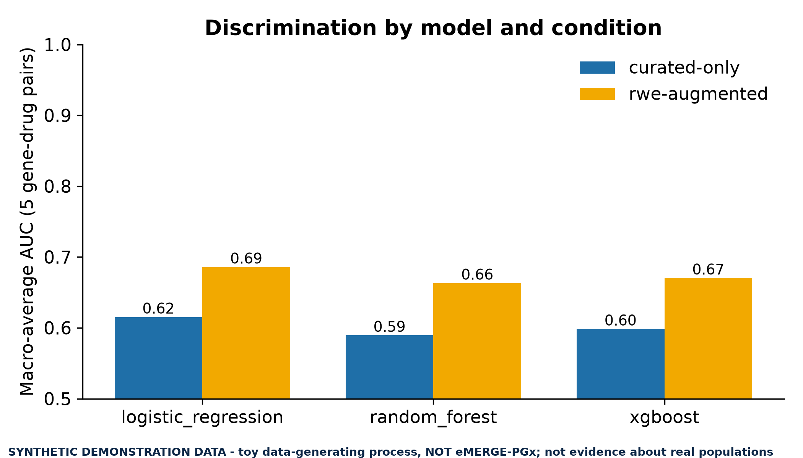
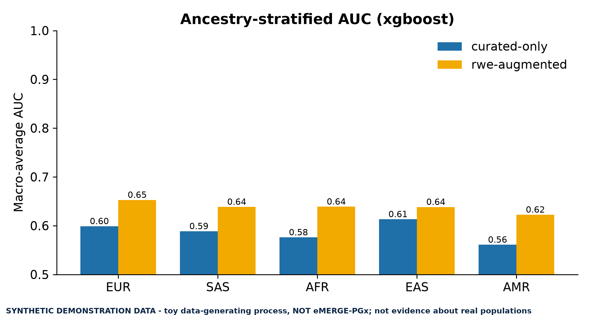
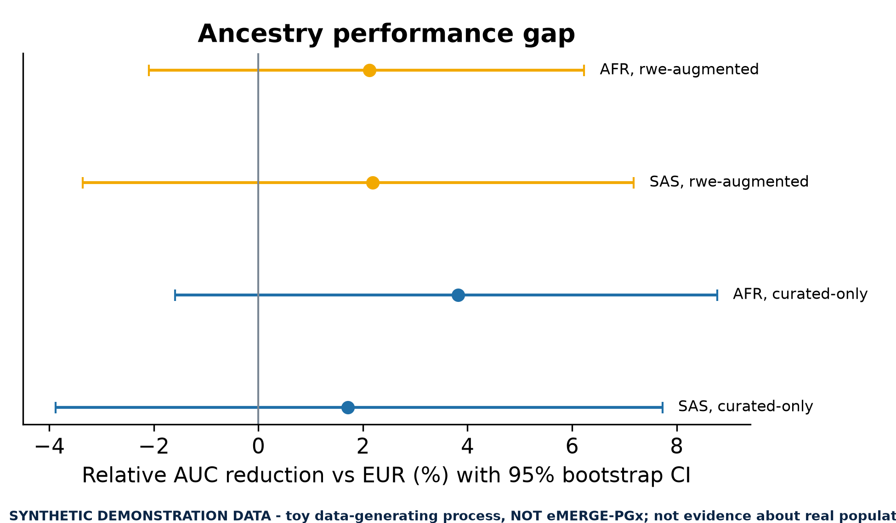
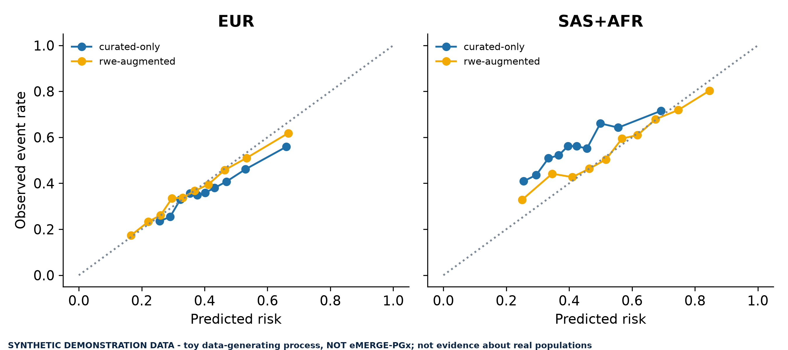
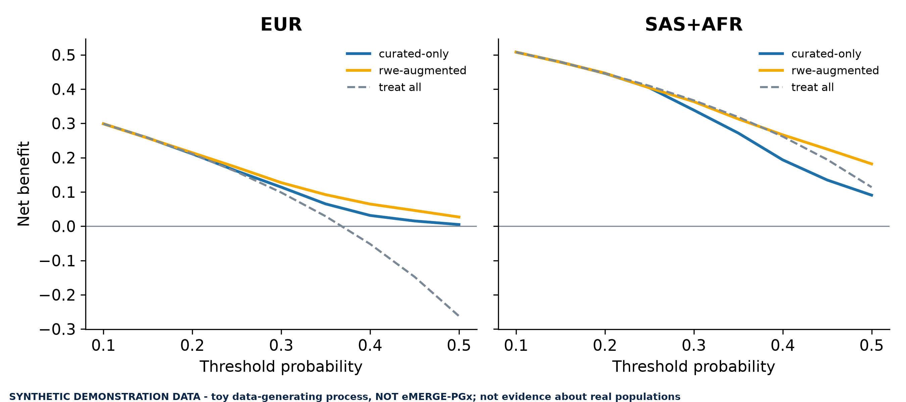

# rwe-pgx-ml-hta

Real-world-evidence (RWE)-augmented machine learning for pharmacogenomic drug response prediction, with
**ancestry-stratified evaluation** relevant to equitable health technology assessment (HTA).
Companion code for the ISPOR Europe 2026 poster *"Integrating Real-World Pharmacogenomic Evidence with Machine Learning for Drug Response Prediction: Implications for Equitable Health Technology Assessment"*
(Jashuva T, Mudigubba MK; RIPER, Anantapur, India). License: **Apache-2.0**.

## Read this first: what the included figures are

The study data (eMERGE-PGx) are controlled-access and **not available to this repository**. The figures and tables in `results/`
were produced from a **synthetic toy data set** (`rwe_pgx_ml.synth`) so the full pipeline can run end to end and be tested.
They are labelled as synthetic on every figure and are **not evidence about real populations and not a reproduction of the abstract**.
The toy data-generating process was not tuned to any published number.

| Quantity | Synthetic demo (this repo) | Abstract (real data, not reproduced here) |
|---|---|---|
| XGBoost macro-AUC, curated-only -> RWE-augmented | 0.598 -> 0.670 | RWE-augmented 0.71-0.79 |
| Relative AUC improvement | See `results/summary.json` | 7-10 % |
| AUC gap, SAS / AFR vs EUR (XGBoost, RWE-augmented) | 2.2 % / 2.1 % (CIs include 0) | 6-11 % |

To obtain the real results, run on your approved extract: `make real` (schema in `data/README.md`).

## Pipeline

1. **Data**: patients x gene-drug pairs (CYP2C19-clopidogrel, CYP2C9/VKORC1-warfarin, SLCO1B1-statins, TPMT-thiopurines, DPYD-fluoropyrimidines) + variant catalog.
2. **Conditions**: curated-only (PharmGKB 1A/1B + ClinVar variants) vs RWE-augmented (+ real-world variants and clinical covariates).
3. **Models**: XGBoost, random forest, logistic regression (scaler fitted inside each fold).
4. **Validation**: ancestry-stratified 10-fold CV (strata = ancestry x outcome); identical folds across models and conditions for paired comparison.
5. **Outcomes**: AUC, calibration (Brier, slope, intercept, ECE), ancestry-stratified AUC, paired bootstrap CIs for RWE-vs-curated difference and relative AUC gap vs EUR.
6. **Exploratory scenario analysis**: decision curves (net benefit) for EUR vs SAS+AFR, as a proxy for prescribing-decision implications.
7. **Interpretability check**: share of XGBoost gain on PharmGKB 1A/1B variants.







## Reproduce

```bash
python -m venv .venv && source .venv/bin/activate
make install && make test && make demo     # synthetic demo -> results/
```
Deterministic (fixed seed); CI re-runs the demo and diffs `results/summary.json`.

## Layout

```
config/config.yaml        pairs, conditions, models, CV, bootstrap, synthetic settings
src/rwe_pgx_ml/           synth, data, models, evaluate, figures, pipeline
tests/                    schema, leakage, feature-set and metric tests
results/                  demo figures (png + pdf), tables, summary.json
data/README.md            required schema; no patient data distributed
```

## Limitations

Per-pair models on pooled out-of-fold predictions; ancestry groups are coarse labels; the exploratory scenario analysis does not model costs or HTA decision rules;
the demo cannot show real-world ancestry gaps.

## Citation / license
`CITATION.cff`; Apache License 2.0 (`LICENSE`, `NOTICE`).
